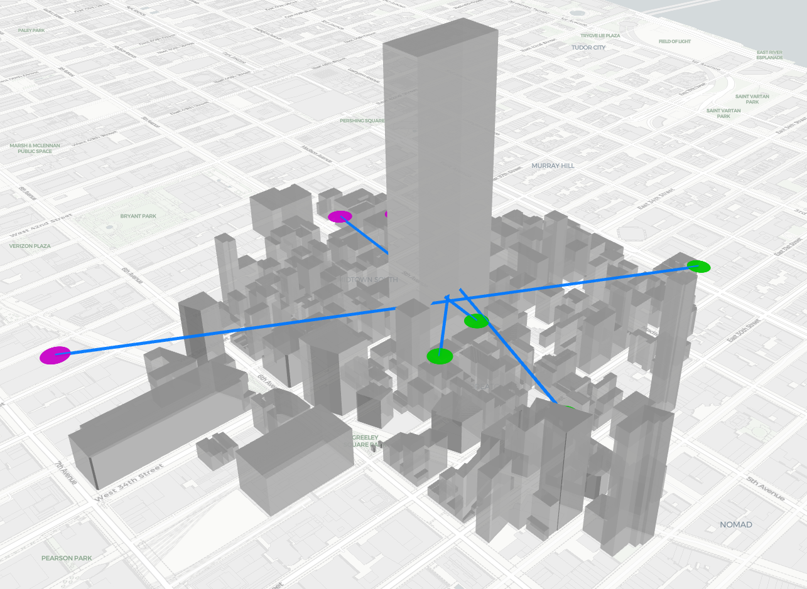
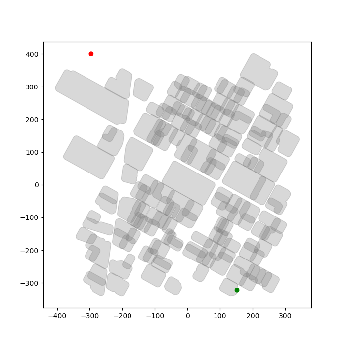
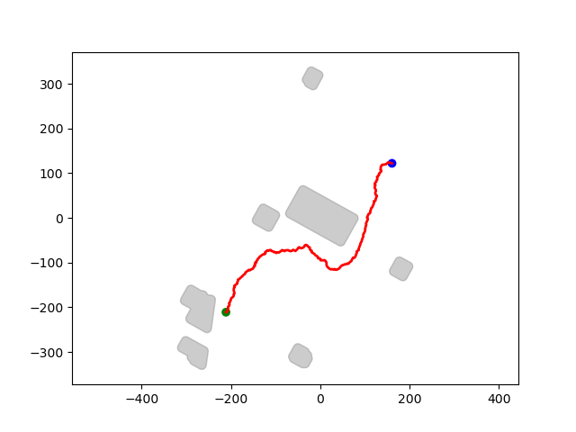
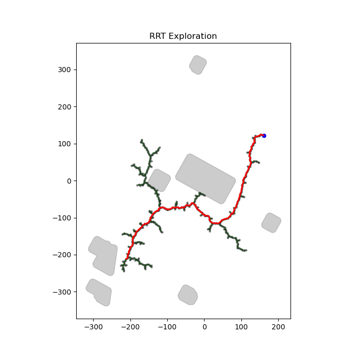
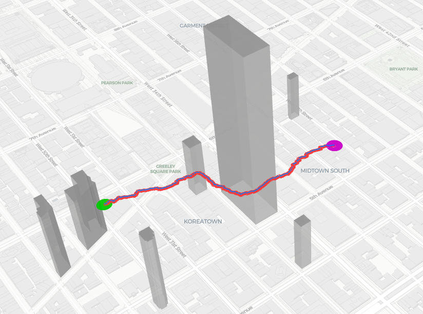
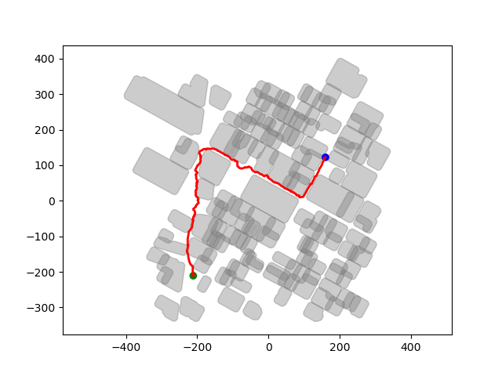
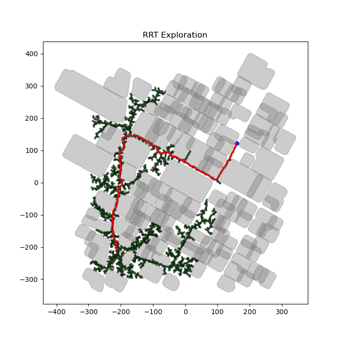
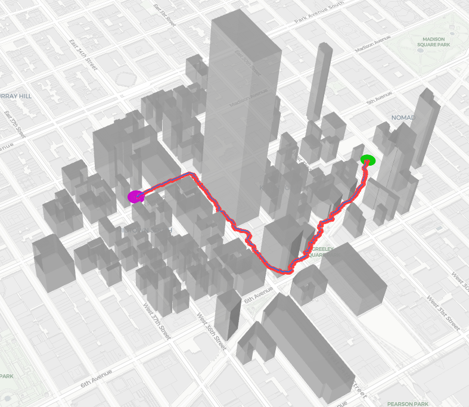

# Drone Route Planning in NYC

***This assignment is to be done as individuals, not with partners nor with teams.***

### How to get started →

Begin by reading this entire writeup and making sure you have a good understanding of it. Take note of the topics in the resources section as your questions might already be covered there. You should aim on identifying what features you need to implement, which ROS nodes and topics you’ll need and how you’ll test and evaluate your package.

---
# Introduction

Rapidly-Exploring Random Trees (RRT) is a path-planning algorithm widely used in robotics for efficiently navigating complex and high-dimensional spaces. It incrementally builds a tree of feasible paths from the robot's start position toward the goal by sampling random points and connecting them with valid trajectories. RRT is particularly effective in environments with obstacles or constraints, making it a robust choice for motion planning in both static and dynamic scenarios. 

This assignment serves as a prototype approach for autonomously routing drones through complex environments to get to the scene as quickly as possible. In this assignment, you will be implementing a RRT planning pipeline for the 2D space by slicing the 3D space.


---
# Assignment Information

Your algorithms/methods can be implemented on any platform that can run the required libraries. You will be implementing a complete pipeline for planning using RRT.

### Objectives

- Integrate graph planning approach for planning in real scenarios
- Learn how to project 3D space to 2D for planning

### Resources

- RRT - [Video](https://www.youtube.com/watch?v=Ob3BIJkQJEw)
- [pydeck](https://deckgl.readthedocs.io/en/latest/)
- [osmnx](https://osmnx.readthedocs.io/en/stable/)
- [pyproj](https://pyproj4.github.io/pyproj/stable/)
- [typing](https://docs.python.org/3/library/typing.html)
- [shapely](https://shapely.readthedocs.io/en/stable/)

>Note: Use pip to install the above libraries

### Requirements

- Your file should run when executed using the python command
- Your planner should be able to consistently generate paths at the lowest altitude possible

### What we provide
- `building_en.py` - utils for projecting an env from OSM to a 2D space
- `plan.py` - environment setup for planning and planner initiation code


### What to submit


```bash
RRT
├── building_env.py # Do not make changes to this file
├── imgs
│   └── .
│   └── .   #image files
│   └── .
├── plan.py #Initialize your RRT class and implement the iterative looping for altitude
├── README.md
└── RRT.py  #Implement your RRT planner class here

```

Some cache might be generated due to the use of the libraries. Make sure that such files are not committed.

*Please make sure you adhere to the structure above, if your package doesn’t match it the grader will give you a **zero***

### Grading considerations

- **Late submissions:** Carefully review the course policies on submission and late assignments. Verify before the deadline that you have submitted the correct version.
- **Environment, names, and types:** You are required to adhere to the names and types of the functions and modules specified in the release code. Otherwise, your solution will receive minimal credit.

---
## Planing Pipeline

You will implement graph based RRT on the OSM map for NYC around Empire State building. The code and the utilities for getting the map and visualizing them are available in `plan.py`



The above image shows a 3D view of the buildings with approximated geometries and the start and end points (in purple and green). 
This 3D map, availabe as a pandas GeoDataFrame is obtained from OSM using OSMnx. The buildings are then sliced using an altitude cutoff to get the area occupied by the building at that altitude. These areas are then transformed into shapely polygons. 



Since the map coordinates are in GPS coordinates, they need to be converted into cartesian coordinates of the space we plan for. This involves using bounding box in GPS coordinates, obtaining its center and transforming the bounding box into a 2D space with origin at the center. The min and max bounds for this space is available via the code in plan.py and can be used for sampling a point for RRT.

The chosen points(samples) can be checked for collision using shapely apis. The collision needs to be checked for start, end points before planning starts(i.e., make sure the start and end are not inside the obstacle space), for a new point (to make sure the new point isn't inside the obstacle space) and between a new point and its parent before the point can be chosen to expand the tree(to ensure collision free path). This can be done using shapely classes and apis:
- [LineString](https://shapely.readthedocs.io/en/stable/reference/shapely.LineString.html)
- [Polygon](https://shapely.readthedocs.io/en/stable/reference/shapely.Polygon.html)

The aim of the assignment is to find a path for the drone from a given start to goal. The path may not exist at several altitudes, so, you should implement code to run RRT iteratively until the lowest altitude is found, for which a viable path exists. A random starter altitude, start and goal coordinates will be given during testing.

## Part 1

This part requires you to implement RRT for a given bounding box(min, max bounds for x and y), buildings(in the form of shapely polygons in 2D), start and end points. For this part, you can take an altitude of 120 as the maximum altitude to plan for, generate the building polygons and plan for it. Create a file `RRT.py` which should contain the class RRT to be used for planning. Initialize the class with the required parameters. An example constructor is given in `plan.py`. Implement a method `get_path` that takes start and goal coordinates as input and returns a path in the 2D planning space.

### Suggested Plan of attack

1. Use an altitude of 120 to slice the buildings and generate polygons
2. Convert gps coordinates to 2D planning space coordinates using the transforms given
3. Implement RRT with the above inputs and the algorithm given
4. Return the path by backtracing the tree from the goal





## Part 2

In this part, given an initial altitude, you will need to iteratively implemnt RRT to find the lowest altitude in which planning is possible for the given start and goal coordinates. 

For the purposes of evaluation, you can set the number of iterations for RRT as 10000. A tolerance of +/- 5 units will be allowed for optimum altitude with 10000 iterations. The planning is only considered successful if the planner is able to produce paths consistently.

You can modify the parts of `plan.py` for altitude setting, building polygon progections and calling RRT so as to loop iteratively.






# Submission and Assessment

---

Submit using the Github upload feature on [autolab](https://autolab.cse.buffalo.edu)

**Note: Make sure your code complies to all instructions, especially the naming conventions. Failure to comply will result in zero credit**

You will be graded on the following. Penalties are listed under each point, absolute values, w.r.t assignment total.

1. Part1 - 60%
2. Part2 - 40%
    
